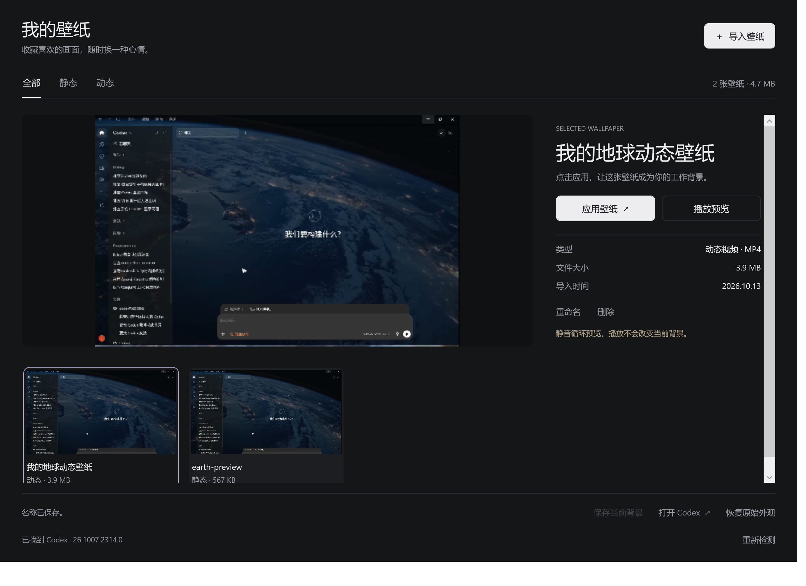
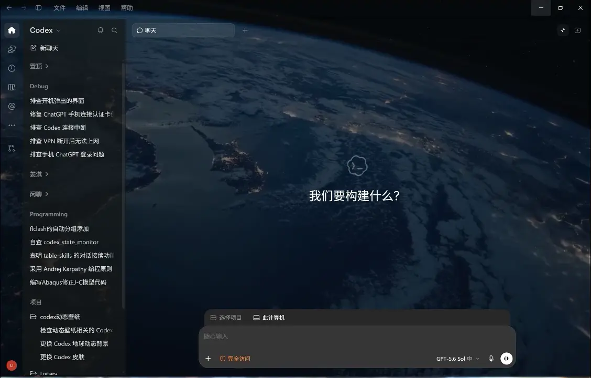

  

<h1 align="center">Codex 换肤管理中心</h1>

为你的 Codex 换上喜欢的图片或动态背景。导入、预览、切换，在一个窗口里完成。

  <a href="https://github.com/JiPaiFan1109/Codex-Dynamic-Skin/releases/latest/download/Codex-Skin-Manager-Setup.exe"><strong>下载 Windows 安装版</strong></a>
  · <a href="README.en.md">English</a> · <a href="CHANGELOG.md">更新记录</a>

  
  
  

本项目是社区开发的独立工具，**非 OpenAI 官方产品，与 OpenAI 无隶属关系**。使用前请安装官方 Microsoft Store 版 Codex。

## 界面与功能

  

- **静态与动态背景**：导入本地图片或视频，为 Codex 更换背景。
- **壁纸收藏库**：卡片浏览、静态/动态分类、大图预览、视频静音播放；支持重命名和删除。
- **自动识别 Codex**：打开管理中心即可检测本机客户端，点击「应用壁纸」或「打开 Codex」进入换肤流程。
- **保留收藏，随时恢复**：导入后移动原文件不影响收藏；升级保留壁纸库，可恢复 Codex 原始外观。

查看 Codex 动态背景效果

[观看完整 MP4 演示](docs/media/earth-demo.mp4) · [获取演示中的地球背景](docs/earth-background.md)

演示录自真实 Codex 窗口，已检查并排除敏感个人信息。地球原视频不随应用分发，需按素材作者要求自行获取。

## 重要更新

| 日期（北京时间） | 版本 | 更新内容 |
| --- | --- | --- |
| 2026-10-13 | [0.2.0](https://github.com/JiPaiFan1109/Codex-Dynamic-Skin/releases/tag/v0.2.0) | Windows 安装应用；完整换肤管理中心与透明图标；自动检测 Codex；清理旧托盘及上游冗余功能 |
| 2026-10-08 | [0.1.3](https://github.com/JiPaiFan1109/Codex-Dynamic-Skin/releases/tag/v0.1.3) | 改进启动入口，阻止多套 Codex 实例并存，迁移旧动态主题 |
| 2026-10-07 | [0.1.2](https://github.com/JiPaiFan1109/Codex-Dynamic-Skin/releases/tag/v0.1.2) | 修复更新后的启动回滚问题，改善再次打开的速度 |
| 2026-10-02 | [0.1.1](https://github.com/JiPaiFan1109/Codex-Dynamic-Skin/releases/tag/v0.1.1) | 自动验证改为静默，适配新版 Codex 首页 |
| 2026-10-01 | [0.1.0](https://github.com/JiPaiFan1109/Codex-Dynamic-Skin/releases/tag/v0.1.0) | 首次公开发布，支持图片、视频背景及外观恢复 |

详细修复内容见 [完整更新记录](CHANGELOG.md)。

## 安装与使用

支持 **Windows x64 + 官方 Microsoft Store OpenAI.Codex 客户端**。本版不支持 macOS、Linux、Windows ARM64 或其他来源的 Codex 安装。

1. **[下载安装程序](https://github.com/JiPaiFan1109/Codex-Dynamic-Skin/releases/latest/download/Codex-Skin-Manager-Setup.exe)**，双击 `Codex-Skin-Manager-Setup.exe` 按向导安装。
2. 从桌面或开始菜单打开 **Codex 换肤管理中心**。窗口底部会显示检测到的 Codex 版本；找不到时先安装官方客户端，再点击 **重新检测**。
3. 点击 **导入壁纸**，选择图片或视频。导入只保存到收藏库；选中后可以先预览。
4. 点击 **应用壁纸** 切换背景。需要重启 Codex 时，先保存工作，再按提示确认。
5. 日常从管理中心点击 **打开 Codex**，或使用开始菜单中的 **打开换肤版 Codex**。需要恢复时点击 **恢复原始外观**。

无需手动安装 Node.js、运行命令或填写 API Key；应用不包含 Codex 本体。原来的右下角托盘菜单不再作为应用入口。

### 支持的素材

| 类型 | 要求 |
| --- | --- |
| 图片 | PNG、JPG/JPEG、WebP，最大 10 MiB |
| 视频 | 原文件最大 2 GiB；导入后转为静音 MP4，转换结果最大 128 MiB |

视频解码取决于本机 Windows 媒体组件。导入失败时可先导出为 H.264 MP4；视频过长或转换后超过限制时，请缩短后重新导入。应用不会自动截取视频。

默认背景为项目生成的 **Night Sky** 图片。演示中的地球背景请按[素材获取说明](docs/earth-background.md)自行获取。

### 升级、卸载与常见问题

- **升级**：运行新版安装程序，壁纸库会保留。
- **卸载**：从 Windows「已安装的应用」卸载。卸载前会执行外观恢复；取消或失败时停止卸载。壁纸库默认保留。
- **未找到 Codex**：确认当前 Windows 用户已安装官方 Store 版客户端，再点击「重新检测」。
- **从官方入口打开后没有皮肤**：回到管理中心点击「打开 Codex」或重新应用壁纸，按提示处理正在运行的会话。
- **Codex 更新后换肤失败**：页面结构和启动方式可能变化，请查看项目新版及 [Releases](https://github.com/JiPaiFan1109/Codex-Dynamic-Skin/releases)。

## 技术说明与源码构建

运行环境、数据位置及兼容安装方式（日常使用可跳过）

- 安装位置固定为 `%LOCALAPPDATA%\CodexDynamicSkin`，无需管理员权限；壁纸库位于其中的 `wallpaper-library`。
- 通过本机注册的官方 Codex 安装信息完成检测，并由本地引擎启动和应用背景。检测成功表示找到了受支持客户端，具体换肤仍需点击应用并完成验证。
- 默认安装、启动和恢复流程不改写全局 `%USERPROFILE%\.codex\config.toml`。兼容旧状态的恢复保护逻辑仍保留。
- 安装包包含固定版本 Node.js 24.19.0 x64 及其许可证，构建时核对 SHA-256 和 OpenJS Foundation 签名。本项目 EXE 尚无项目代码签名证书；上游 Node.js 签名不代表安装程序已签名，不要求关闭 Windows 安全保护。
- 视频由 Windows 自带媒体组件转换为静音 H.264 MP4，保持比例，最高 1920 × 1080、30 fps。
- 仍提供 [Release ZIP](https://github.com/JiPaiFan1109/Codex-Dynamic-Skin/releases)：完整解压后运行 `Install.cmd`。GitHub 自动生成的源码 ZIP 不含运行环境。
- 程序运行和视频播放会占用内存及 CPU/GPU；不承诺所有 Codex 版本兼容或完全没有性能开销。

开发与验证：[构建说明](docs/windows-application.md) · [安装应用验证](docs/windows-application-validation.md) · [上线前清理审查](docs/pre-release-audit.md) · [安全说明](SECURITY.md)

## 开源来源与许可证

本项目基于 [Codex Dream Skin](https://github.com/Fei-Away/Codex-Dream-Skin) v1.5.18 开发，保留必要的本地换肤、启动和恢复实现。

项目代码按 **[MIT License](LICENSE)** 提供，保留上游 `Copyright (c) 2026 Codex Dream Skin Studio contributors` 声明。[第三方声明](THIRD_PARTY_NOTICES.md)列出上游来源、Node.js 许可及素材使用边界。MIT 不覆盖第三方壁纸、OpenAI 品牌或官方应用资源。

## 打赏作者一杯蜜雪冰城喝

如果这个小工具对你有帮助，欢迎支持后续维护。

  

